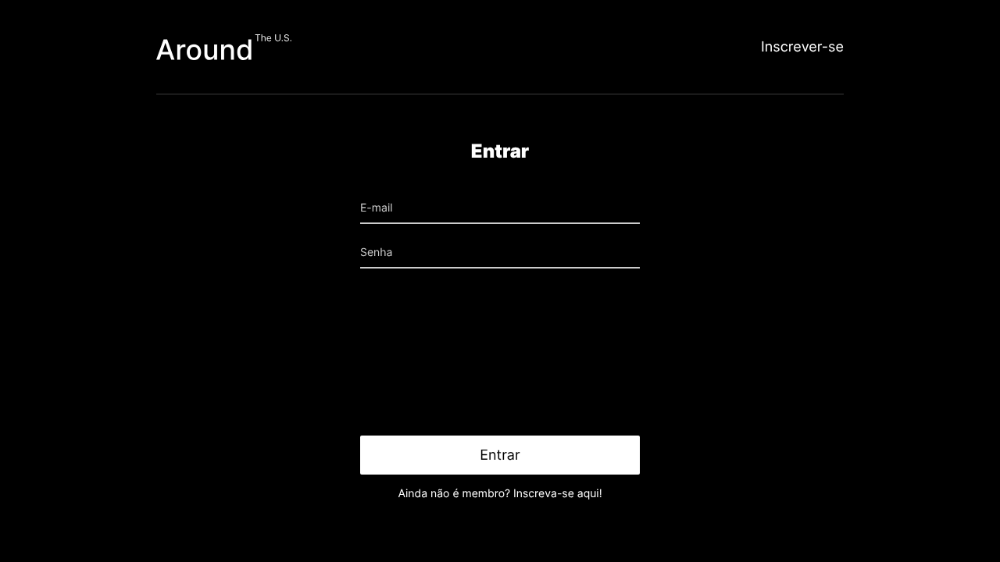
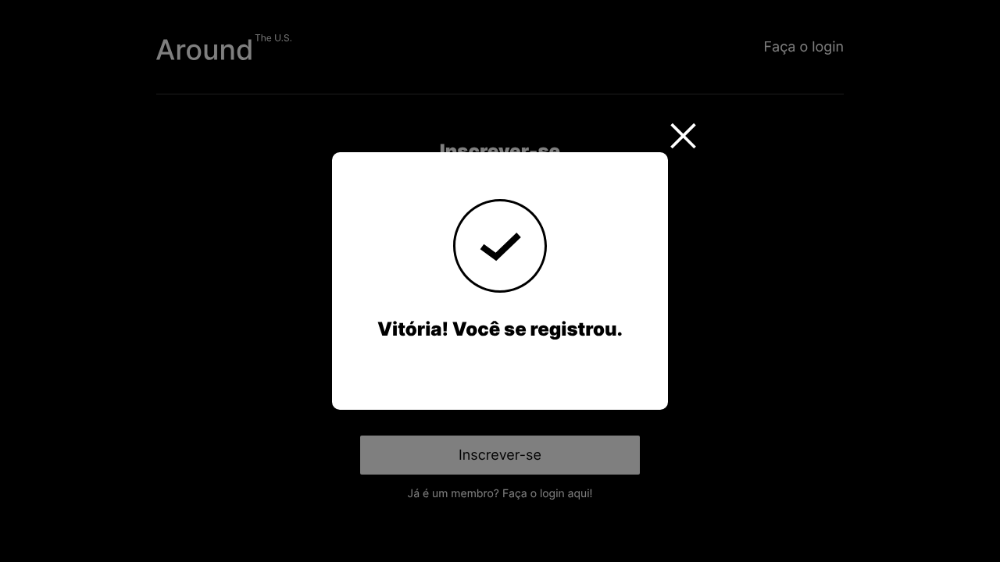
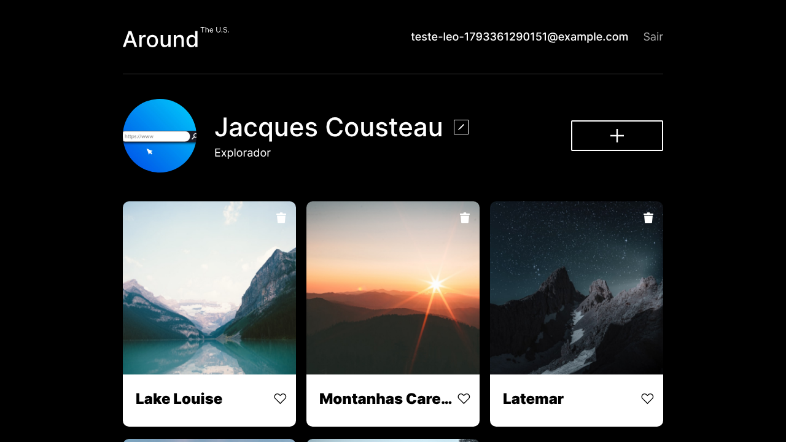
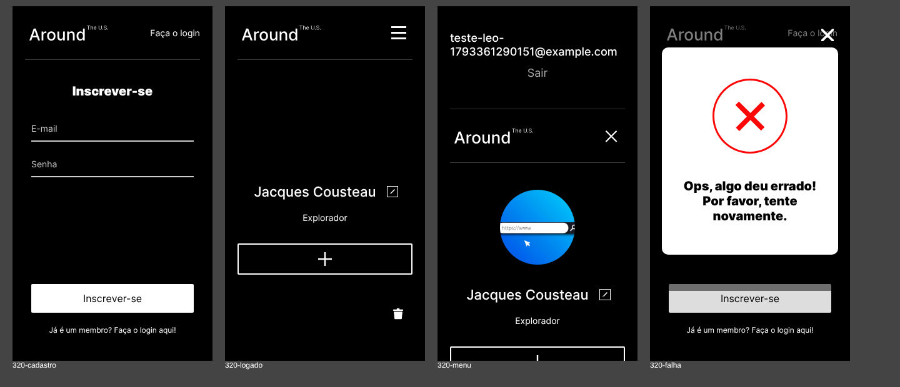

# 🔐 Around The U.S. — Cadastro e login em React

## 📅 Sprints

Projeto da **Sprint 17** do curso de Desenvolvimento Web da TripleTen Brasil.
Parte do código do Projeto 14
([`web_project_around_react`](https://github.com/oleodias/web_project_around_react),
Sprints 13 e 14), que por sua vez reescreveu em React o projeto das Sprints 8
a 12 ([`web_project_around_pt`](https://github.com/oleodias/web_project_around_pt)).
O back-end próprio está em
[`web_project_around_express`](https://github.com/oleodias/web_project_around_express)
(Sprints 15 e 16).

| Sprint | O que foi feito neste repositório                                                                                                                                   |
| ------ | ------------------------------------------------------------------------------------------------------------------------------------------------------------------- |
| 17     | cadastro, login e logout com JWT, rotas protegidas, `localStorage`, aviso de sucesso/erro e o cabeçalho para visitantes e usuários logados, com versão para celular |

---

## 📝 Descrição do Projeto

**Around The U.S.** é a galeria de lugares do curso: perfil, cartões com fotos,
curtidas e pop-ups para editar, adicionar, ampliar e excluir. Nesta etapa, a
galeria passou a exigir **cadastro e login**: só quem entrou vê a página
principal, e o login fica lembrado entre as visitas.



### O que o usuário pode fazer

- **Cadastrar-se** em `/signup` com e-mail e senha. Um aviso informa se deu
  certo ou não; depois do sucesso, o app leva ao login
- **Entrar** em `/signin`. O app recebe um **JWT**, guarda no `localStorage` e
  abre a galeria em `/`
- **Continuar logado** ao recarregar ou voltar outro dia: na abertura, o app
  confere o token com o servidor e mostra o e-mail no cabeçalho
- **Sair**: o token é apagado e o app volta ao login
- Tudo o que já existia: editar perfil e foto, adicionar, curtir e excluir
  cartões

| Cadastro concluído                                                    | Logado                                                            |
| --------------------------------------------------------------------- | ----------------------------------------------------------------- |
|  |  |

No celular, o e-mail e o "Sair" ficam num menu aberto pelo botão de três
linhas:



### Resumo

- **O que foi construído e por quê:** a camada de autenticação do Around em
  React: cadastro, login e logout com JWT, um `ProtectedRoute` que só libera a
  galeria para quem entrou e o token guardado no `localStorage`, para que cada
  pessoa tenha acesso à própria conta.
- **Problema que resolve:** impede o acesso à galeria sem login, avisa na tela
  quando o cadastro dá certo ou o login falha (401), mantém a sessão ao
  recarregar (o token é conferido com o servidor) e oferece um menu próprio no
  celular.
- **Tecnologias:** React 19 (hooks e Context API), React Router 6, JWT com
  `Authorization: Bearer`, `localStorage`, Fetch API, Vite 8, CSS com BEM Flat,
  Prettier e oxlint.

---

## 🎬 Demonstração em vídeo

> 🔗 **Vídeo:** [assistir no Google Drive](https://drive.google.com/file/d/12BrX-norUG9zt-wRWkC5zVKYklAEfAOV/view?usp=sharing)

Vídeo de **2min05** (1080p, 60 fps, legendas em português) com o código deste
repositório, **sem alterações**, rodando com `npm run dev` e ligado às **APIs
reais** da TripleTen: a de autenticação e a do Around.

| Capítulo             | O que aparece                                                | Onde está no código                            |
| -------------------- | ------------------------------------------------------------ | ---------------------------------------------- |
| 01 · Rota protegida  | abrir `/` sem login leva a `/signin`                         | `ProtectedRoute`                               |
| 02 · Cadastro        | conta nova criada ao vivo (`POST /signup` → 201) e o aviso   | `Register`, `auth.register`, `InfoTooltip`     |
| 03 · Erro no login   | senha errada (`POST /signin` → 401) e o aviso de erro        | `handleLogin` no `App`                         |
| 04 · Login com JWT   | token salvo, e-mail no cabeçalho e galeria carregando        | `auth.authorize`, `setToken`                   |
| 05 · Sessão lembrada | recarregar e continuar logado (`GET /users/me` com `Bearer`) | `useEffect` com `getToken` e `isCheckingToken` |
| 06 · Galeria         | curtir e descurtir, como no Projeto 14                       | `api.changeLikeStatus`                         |
| 07 · No celular      | o menu de três linhas com o e-mail e o "Sair" (390px)        | `Header` (`header__menu-button`)               |
| 08 · Sair            | token apagado e `/` volta a ser protegida                    | `handleSignOut`, `removeToken`                 |

**Como o vídeo foi feito:** a tela é uma gravação real do navegador
(Playwright). A barra de endereço e o indicador "jwt ✓ salvo / jwt —" mostram a
URL e o estado do token registrados durante a própria gravação. Por cima há só
uma camada de _motion_ (câmera, cursor, setas, destaques, legendas e
capítulos), feita com Python, Cairo e ffmpeg. A conta de demonstração usa um
e-mail fictício; a senha aparece só como pontos, e o JWT e o token do curso
nunca aparecem.

**Trilha sonora:** original, composta e sintetizada por código para o vídeo
(sem samples nem músicas de terceiros), sincronizada com as animações.

---

## 🚩 Sprint 17 — Como a autenticação funciona

```
abrir o app ── há token no localStorage? ── não ──▶ /signin
                         │ sim
                         ▼
               GET /users/me (Bearer token) ── inválido ──▶ apaga o token, /signin
                         │ válido
                         ▼
               isLoggedIn = true, e-mail no cabeçalho, perfil e cartões
```

| Peça                 | Papel                                                                                                           |
| -------------------- | --------------------------------------------------------------------------------------------------------------- |
| `utils/auth.js`      | `register`, `authorize` e `getUserData` na API de autenticação da TripleTen (`/signup`, `/signin`, `/users/me`) |
| `utils/token.js`     | `setToken`, `getToken` e `removeToken` no `localStorage`                                                        |
| `ProtectedRoute`     | envolve a rota `/`: sem login, `<Navigate to='/signin' replace />`                                              |
| `Register` e `Login` | formulários controlados (`email`, `password`); só entregam os dados ao `App`                                    |
| `InfoTooltip`        | o aviso de sucesso ou erro, com a moldura dos outros pop-ups                                                    |
| `App`                | todas as solicitações, as rotas, `isLoggedIn`, `email` e os manipuladores `onRegister`, `onLogin` e `onSignOut` |

### Decisões

| Decisão                                                                                                 | Motivo                                                                                                                                                                |
| ------------------------------------------------------------------------------------------------------- | --------------------------------------------------------------------------------------------------------------------------------------------------------------------- |
| Duas APIs                                                                                               | A de autenticação só tem `/signup`, `/signin` e `/users/me` (conferido: `/cards` responde 404). Perfil e cartões continuam na API do Around, como no Projeto 14       |
| Estado `isCheckingToken`                                                                                | Enquanto o servidor confere o token salvo, as rotas não são desenhadas. Sem isso, quem já entrou passaria pela tela de login a cada recarga (conferido que não passa) |
| Token salvo no **login**                                                                                | É a resposta do `/signin` que traz o token; o cadastro só devolve o e-mail e o `_id`                                                                                  |
| Token inválido ou vencido é apagado                                                                     | Senão o app tentaria de novo a cada visita                                                                                                                            |
| Perfil e cartões pedidos quando o usuário entra                                                         | Uma solicitação de cada: na abertura, se o token vale, ou logo depois do login                                                                                        |
| `/signup` e `/signin` fora do `ProtectedRoute`                                                          | Pedido do checklist; quem já entrou é mandado para `/`                                                                                                                |
| Link do cabeçalho na tela de login: **"Inscrever-se"**                                                  | O design traz "Entrar", que levaria à própria página; o link certo é o do cadastro                                                                                    |
| Mensagens do aviso: "Vitória! Você se registrou." e "Ops, algo deu errado! Por favor, tente novamente." | O design diz "Você precisa se registrar" (o contrário do que aconteceu) e "algo saiu deu errado"                                                                      |
| O aviso de erro também aparece quando o login falha                                                     | Senha errada ou usuário inexistente (401) precisam de resposta na tela                                                                                                |
| `no-undef` ativado no oxlint                                                                            | O modelo da Vite não traz essa regra, e uma variável indefinida só aparecia ao rodar                                                                                  |

---

## 🛠 Tecnologias Utilizadas

- **React 19** com componentes funcionais e os hooks `useState`,
  `useEffect`, `useContext` e `useRef`; Context API
- **React Router 6**: `Routes`, `Route`, `Navigate`, `Link`, `useNavigate`,
  `useLocation`
- **JWT** no cabeçalho `Authorization: Bearer <token>`, guardado no
  `localStorage`
- **Fetch API** com promessas
- **Vite 8**, **CSS com BEM Flat** (um arquivo por bloco), **Prettier** e
  **oxlint**

---

## 📐 Estrutura do Projeto

```
src/
├── blocks/                         ← CSS por bloco (auth.css é novo)
├── components/
│   ├── App.jsx                     ← rotas, estados e solicitações
│   ├── Header/Header.jsx
│   ├── Footer/Footer.jsx
│   ├── Register/Register.jsx
│   ├── Login/Login.jsx
│   ├── ProtectedRoute/ProtectedRoute.jsx
│   ├── InfoTooltip/InfoTooltip.jsx
│   └── Main/                       ← galeria, Card, Popup e os pop-ups
├── contexts/CurrentUserContext.js
├── images/
├── utils/
│   ├── api.js                      ← API do Around (perfil e cartões)
│   ├── auth.js                     ← cadastro, login e /users/me
│   └── token.js                    ← o JWT no localStorage
├── index.css
└── main.jsx                        ← BrowserRouter
```

---

## 💻 Como executar localmente

```bash
npm install
cp .env.example .env   # depois troque o valor de VITE_API_TOKEN pelo token do curso
npm run dev
```

O navegador abre em `http://localhost:3000`.

> 🔑 **Revisor(a):** o perfil e os cartões vêm da API do Around, que exige o
> token do curso. Ele **não está no repositório de propósito**: um token
> versionado fica público no histórico do GitHub. Coloque-o no `.env`, na
> variável `VITE_API_TOKEN` (o mesmo token usado nos Projetos 13 e 14), e
> reinicie o `npm run dev`, porque o Vite só lê o `.env` ao iniciar.
>
> Sem o token, o cadastro, o login, as rotas protegidas e o "Sair" funcionam
> normalmente (a API de autenticação não precisa dele); só a galeria e o
> perfil ficam vazios.

---

## 📈 Próximos passos

1. Ligar o app ao back-end próprio (Sprint 18)
2. Mensagens de validação nos campos dos formulários

---

## 👤 Autor

**Leonardo Dias Caumo** — _Desenvolvido como parte do portfólio de estudos em Desenvolvimento Web da TripleTen Brasil._
